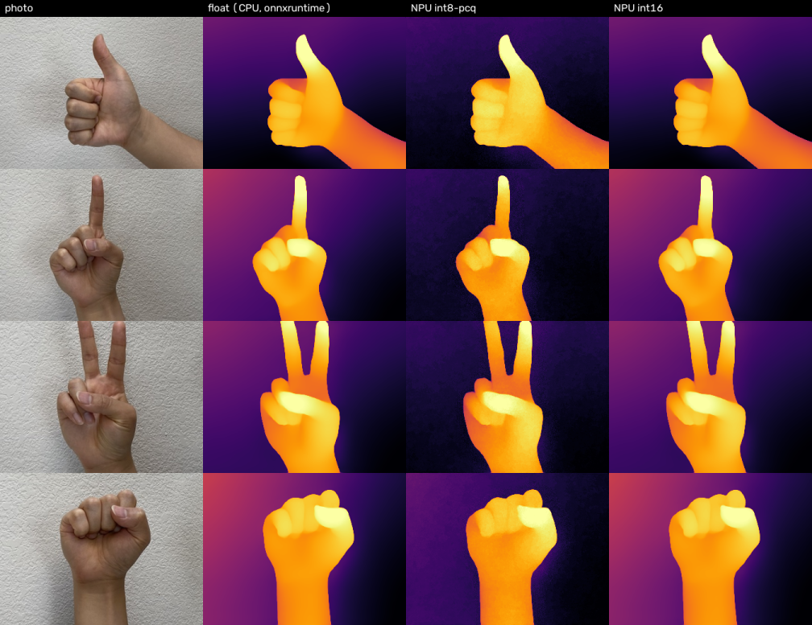
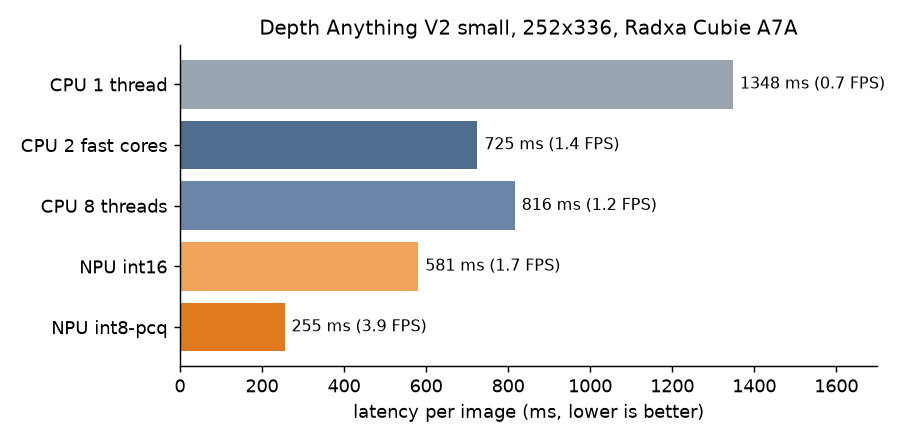

# Depth Anything V2 (small) on the Radxa Cubie A7A NPU

[Depth Anything V2](https://github.com/DepthAnything/Depth-Anything-V2) small (ViT-S DINOv2 encoder + DPT head, ~25M parameters) running on the Allwinner A733 NPU at a fixed 252x336 input. It gives a relative depth map from a single image. This was my "can the NPU handle a real transformer vision model, not just a classifier" test.



*Photo, float model on CPU, NPU int8, NPU int16. Sample photos from MediaPipe's test assets.*

## Results

Radxa Cubie A7A, 252x336 input, batch 1.

| | time | FPS | vs float (12 of my photos, Pearson correlation of the depth map) |
|---|---|---|---|
| **NPU int8 (pcq)** `da_small_int8pcq.nb` (35 MB) | **255 ms** | 3.9 | mean 0.964, worst 0.84 |
| NPU int16 `da_small_int16.nb` (58 MB) | 581 ms | 1.7 | 1.000 |
| CPU, 1 thread (onnxruntime fp32) | 1348 ms | 0.7 | reference |
| CPU, 2 fast cores | 725 ms | 1.4 | reference |
| CPU, 8 threads | 816 ms | 1.2 | reference |

An Intel i3-1005G1 laptop does it in 210 ms, which is faster than the NPU's int8 build. So the NPU is a 3x win over the board's own CPU, but this is not a real-time model on this board.



On the four photos in the picture the int8 correlations with float are 0.99, 0.95, 0.98, 0.96 and int16 is 1.00. int8 keeps the structure but adds visible speckle noise on flat areas, so for smooth depth I'd use int16 and accept the 2x slower speed. Output is relative inverse depth (bigger = closer), not metric.

The `.nb` files are too big for the repo, so they are in the [GitHub release](../../releases) (`da_small_int8pcq.nb`, `da_small_int16.nb`). `models/` has their metadata.

## What I used

- **Board:** Radxa Cubie A7A (Allwinner A733, 8x Cortex-A55, VeriSilicon Vivante NPU), Debian 11, kernel 5.15.147-a733. The NPU is driven through VIPLite with the `awnn_inference` wrapper that was already installed on my board (`~/awnn_inference`).
- **Converter:** the NPU toolchain docker image `ubuntu-npu:v2.0.10.1` (Acuity 6.30.22 + Vivante IDE 5.11), for the Allwinner A733 NPU. I didn't build it and I'm not redistributing it, so check Radxa's NPU documentation for where to get it. Everything below that says "in the container" runs there, with this repo mounted at `/workspace/mp` (for example `docker run -v $PWD:/workspace/mp ...`). The scripts assume that path.
- **Tools on the board:** `scripts/nb_bench.cpp` is a small timing / smoke-test program I wrote for `.nb` files. Build it on the board:

```
g++ -O2 -std=c++14 -pthread scripts/nb_bench.cpp -I ~/awnn_inference/include -L ~/awnn_inference/install/lib \
    -lawnn_inference -lNBGlinker -lVIPhal -Wl,-rpath,$HOME/awnn_inference/install/lib -o ~/nb_bench/nb_bench
export LD_LIBRARY_PATH=$HOME/awnn_inference/install/lib
~/nb_bench/nb_bench -m model.nb -n 100                      # latency with random input
~/nb_bench/nb_bench -m model.nb -n 1 -i0 input.bin -o out.bin   # real input (raw bytes), outputs saved as float32 (out.bin, out.bin.1, ...)
```

`scripts/board_eval.sh` wraps that: copy a model and a folder of `*.in.bin` files to the board, run them all, copy the outputs back.

## How I converted it

Source: [onnx-community/depth-anything-v2-small](https://huggingface.co/onnx-community/depth-anything-v2-small) (`scripts/get_model.sh`). The small model is Apache-2.0; the larger Depth Anything V2 models are not, so check before swapping in a bigger one.

This was the messiest conversion so far. `scripts/prepare.sh` does the following in the container:

1. **Fixed input size.** The ONNX has dynamic height/width. Pick a multiple of 14 (the patch size): I used 252x336. `da_prep.py` sets the shape (and `ir_version` 8, since the container's ONNX can't read newer files), then `onnxsim`.
2. **Shape ops** (`da_fold.py` + `onnxsim`), same trick as in the DeiT repo.
3. **Constant bicubic resize.** The DINOv2 position embeddings are resized bicubically to the new grid. Its input is a constant, so `da_constresize.py` runs that one node in onnxruntime and replaces it with the result.
4. **Resize / Squeeze / kernel_shape fixes** (`onnx_patch.py`): the DPT head's bilinear `Resize` nodes use `sizes`; Acuity wants `scales`. Also Squeeze/Unsqueeze become Reshape with a constant shape, and `kernel_shape` is added to Conv/ConvTranspose if it is missing. (This script came from an earlier stereo-depth project of mine.)
5. **GELU's `Erf` -> `tanh` approximation** (`erf_patch.py`), as in the DeiT repo.
6. The patched float model matches the original to within 0.03 on depth values (range about 0.2 to 7).
7. **Convert:** `bash scripts/mp_convert_onnx.sh da da_npu.onnx /workspace/mp/calib336/dataset.txt "123.675 116.28 103.53" "0.017125 0.017507 0.017429" pcq i16`. Calibration: 47 photos centre-cropped to 336x252. Input to the board is raw uint8 RGB, 252 rows x 336 columns, HWC.
8. **Check:** `scripts/da_ref.py` makes reference depth maps and raw inputs, `board_eval.sh` runs the board, `da_cmp.py` compares.

Both builds compiled on the first try after the above. The int16 file is 58 MB and still loads and runs fine on the board.

## Caveats

- 252x336 only. Other sizes need a redo of steps 1-7; I haven't tried.
- Correlation is relative to the float model, not to ground-truth depth. I did not check metric accuracy.
- I don't know whether `Erf` would have worked as is.
- The NPU has a single core, so running this next to another model makes them take turns.

## Things that cost me time (Acuity / A733 in general)

These are not specific to this model, so if you convert something else you will probably hit them too.

1. **Export for the right chip.** `--optimize VIP9000NANODI_PLUS_PID0X1000003B` is the A733. An older target I tried first (`VIP9A00NANOQI_PID0X10001029`) gave empty `.nb` files and "Fatal model generation error".
2. **Use `pegasus_patched.py`.** The plain `pegasus.py` in my container failed because there was no torch installed. `env.sh` sets `$PEG` to the patched one.
3. **Put the normalisation on the NPU.** In the input meta I set `add_preproc_node: true`, `reverse_channel: false` and per-channel mean/scale, so the board feeds raw uint8 RGB. Same for the output: `add_postproc_node: true` gives you float32 outputs, which is all the wrapper's output reader understands.
4. **`reverse_channel: false` matters.** The generated default is `true`, which silently flips the channel order of the calibration data. For images that just hurts accuracy a bit; for non-image tensors it scrambled everything (see the SmolLM2 repo).
5. **Always compare the quantised simulator with the float model before trusting a `.nb`**, and then compare the board with the simulator. They do not always agree (see the palm detector below).
6. **Quantisation choice is per model.** int8 per-channel (`pcq`) is fast and fine for some networks, wrecks others; `int16` (`dynamic_fixed_point`) is about 1.5-3x slower but usually close to lossless.

## Credits

[Depth Anything V2](https://github.com/DepthAnything/Depth-Anything-V2) (Yang et al.), ONNX export by onnx-community. Sample photos from MediaPipe's test assets.

## Licence

The scripts and docs here are MIT (see `LICENSE`). The neural networks are not mine and keep their own licences; check the model card of the original before reusing a converted `.nb`.
